# vijPlots

A [jamovi](https://www.jamovi.org) module. Main statistical charts, all built with **ggplot2** and offering extensive customization options:

- **Continuous variables**: Histogram, Box plot, Raincloud plot, Scatter plot, Error bar chart, Lollipop plot, QQ plot
- **Categorical variables**: Bar plot, Pie chart, Mosaic plot, Likert plot
- **Time series**: Line chart, Area chart
- **Multiple Response**: Frequencies, Crosstab

The module is available in the **Plots** tab.

## Histogram

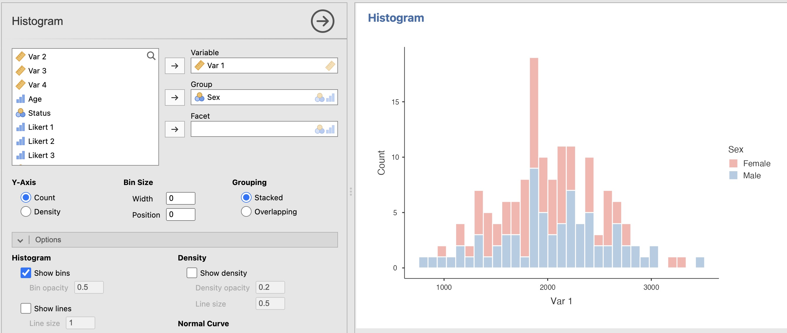

## Box Plot

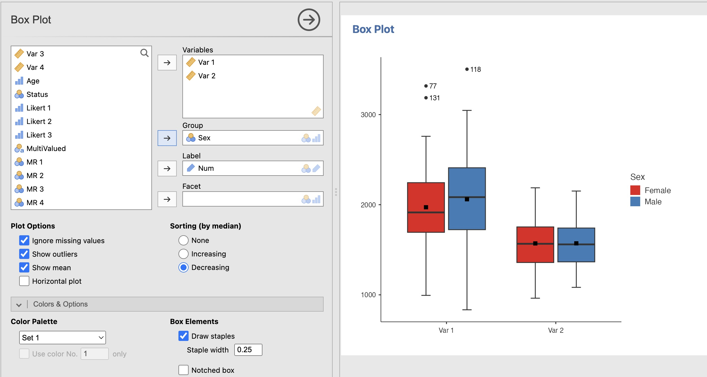

## Scatter Plot

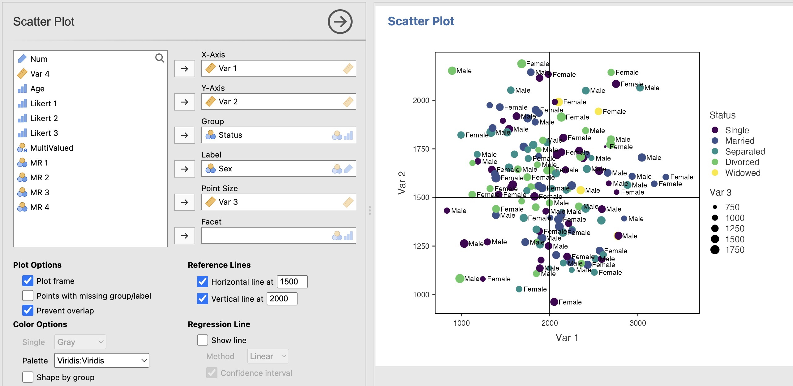

## Error Bar Chart (for quantitative variables)

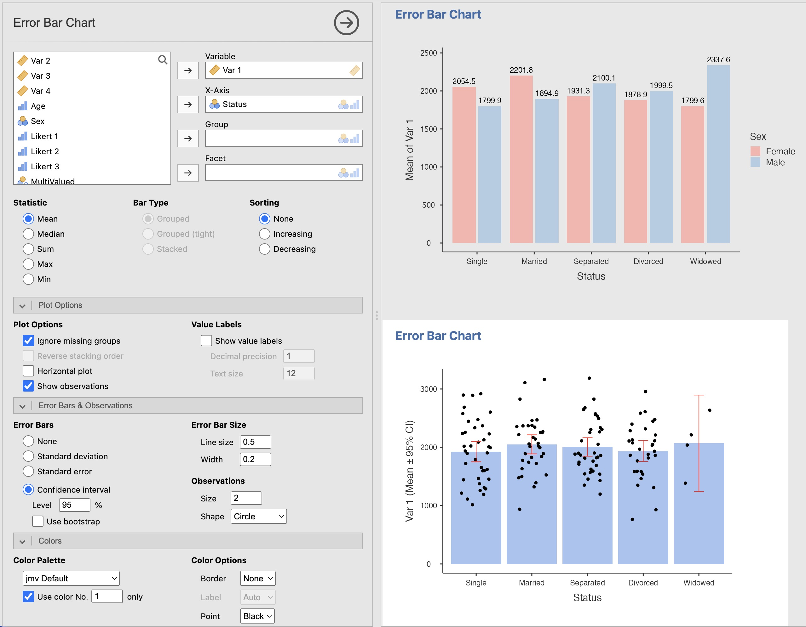

## Lollipop Plot

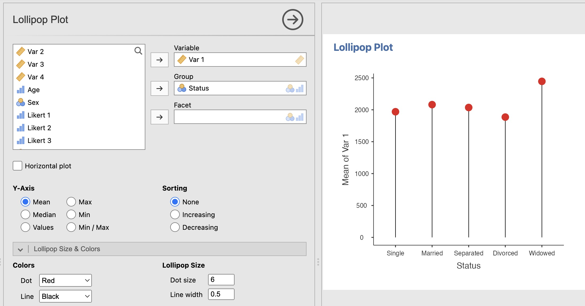

## Raincloud Plot

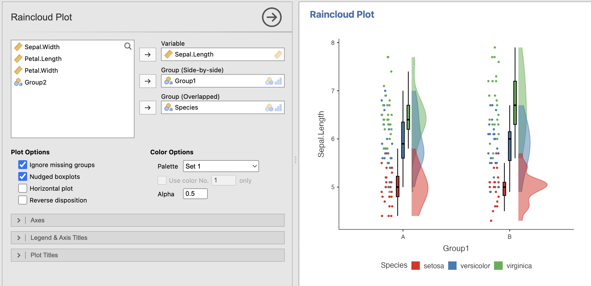

## QQ Plot

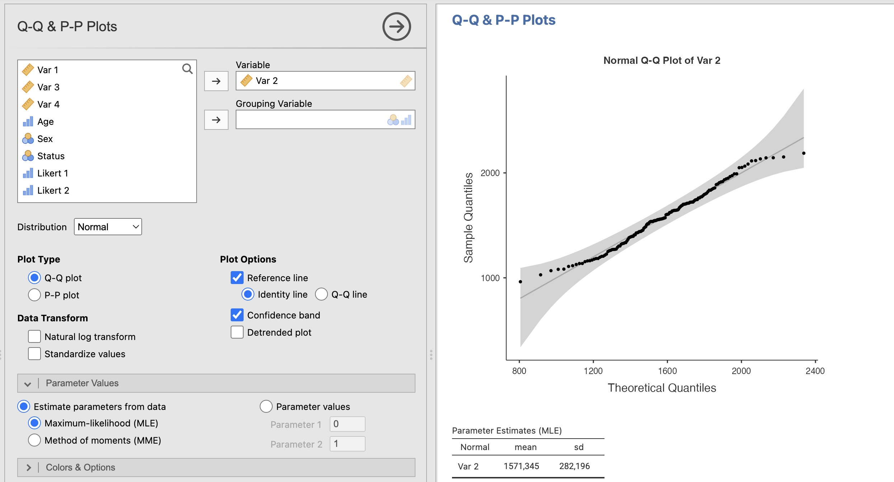

## Bar Plot (for qualitative variables)

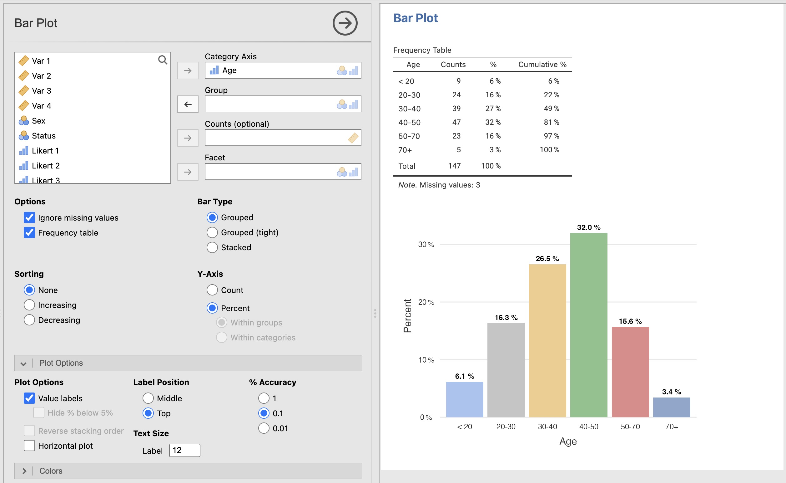

## Pie Chart

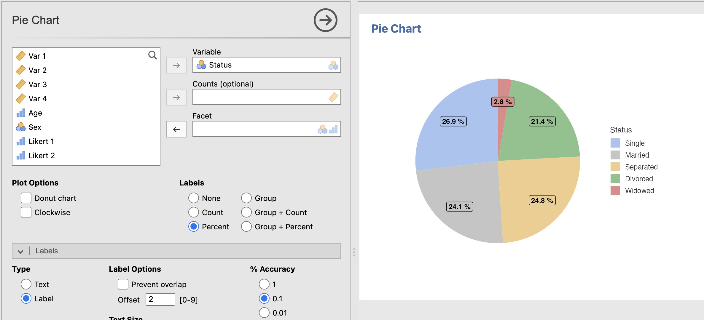

## Mosaic Plot

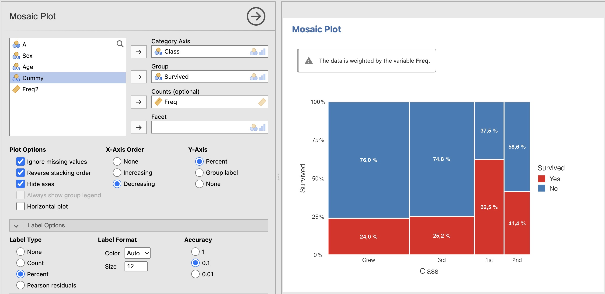

## Likert Plot

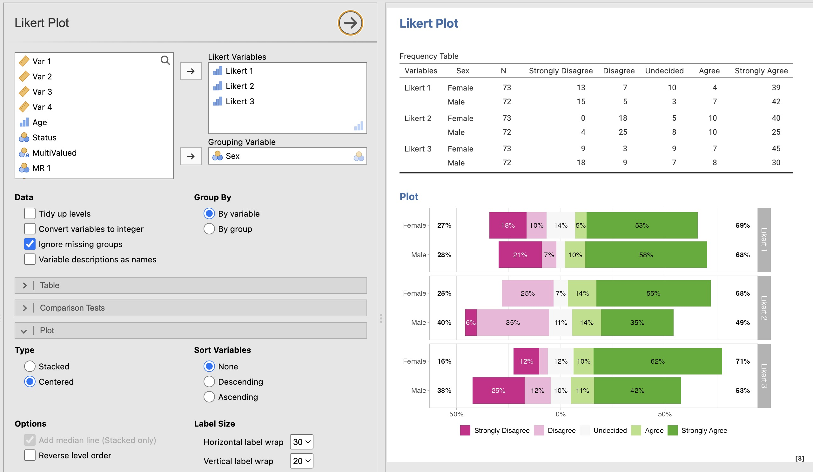

## Multiple Responses

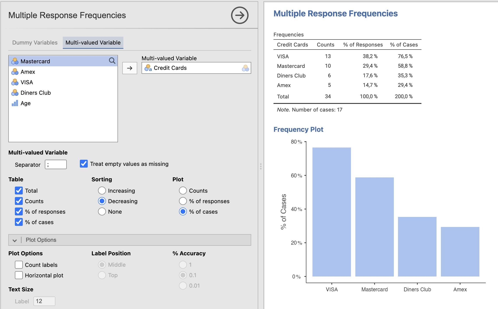

## Line Charts

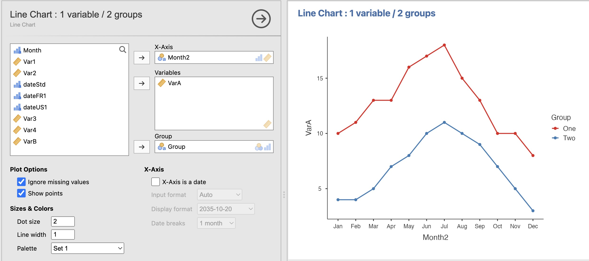

## Area Chart

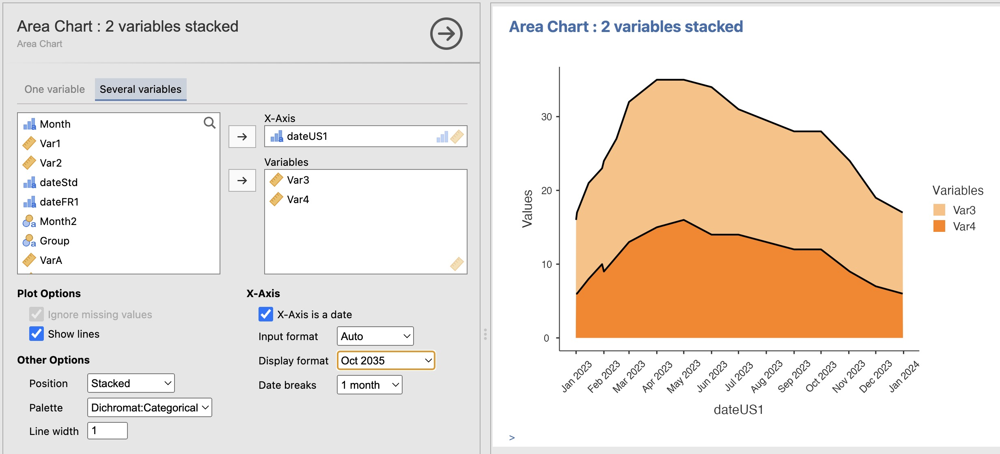

## Last changes: vijPlots 1.5.0 (2026-11-23)

- Pie Chart: option to combine the small categories into an "Other" category (automatically or below a given proportion), with its own label and color
- Bar Plot: option to combine the small categories of the category axis and/or the group into an "Other" category (automatically or below a given proportion), with its own label and color
- Q-Q & P-P Plots: with a grouping variable, the data are now standardized and the distribution parameters estimated within each group (they were computed on all the data, so groups were compared to a pooled distribution)
- Mosaic Plot: the Pearson residuals now include the missing values kept as a category (when "Ignore missing values" is unchecked)
- Scatter Plot: "Free scales" option for facets
- Scatter Plot: "Group shapes" now supports up to 18 groups (instead of 11)

## References

- Larmarange J. (2026). ggstats: Extension to 'ggplot2' for Plotting Stats. R package version 0.13.0, <https://github.com/larmarange/ggstats>
- Almeida, A., Loy, A., Hofmann, H. (2025). qqplotr: Quantile-Quantile Plot Extensions for 'ggplot2'. R package version 0.0.7, <https://github.com/aloy/qqplotr>
- Engler, J.B. (2026). tidyplots: Tidy Plots for Scientific Papers, <https://tidyplots.org>
- Nan Xiao (2026). ggsci: Scientific Journal and Sci-Fi Themed Color Palettes, <https://nanx.me/ggsci/>
- IBM. Carbon Design System — Color palettes. <https://carbondesignsystem.com/data-visualization/color-palettes/>
